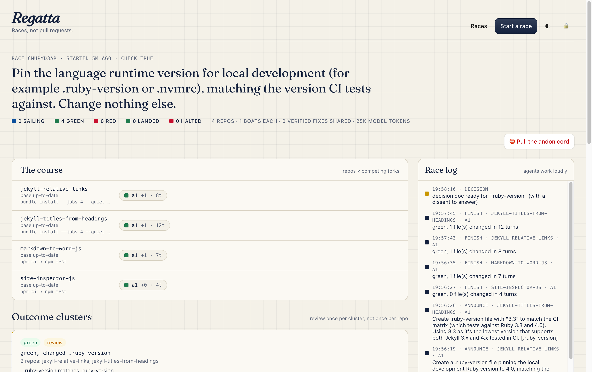

# Regatta

**Races, not pull requests.** Give Regatta one intent and a list of repos. Coding agents race it across every repo, share what they learn, and bring you decisions instead of diffs.

Regatta is an entry in Cloudflare's [build the next Git platform](https://blog.cloudflare.com/next-git-platform-on-cloudflare/) competition. It's built entirely on Cloudflare: Workers, Durable Objects, Workflows, Containers, Artifacts, the Agents SDK, Workers AI, AI Gateway, R2, Queues, Access and Astro.



## Why

Agents made code changes cheap. Review didn't get cheaper. Point today's agent tools at forty repos and you get forty pull requests, each reviewed as if it were the only one. That's GitHub with agents added on top.

Regatta makes a different bet. The unit of work is a **race**: one intent, run across many repos, with K competing agents ("boats") per repo. Three ideas do the work:

1. **Fix it once.** When one boat gets a failing check passing, its fix goes on the race's blackboard. Boats in other repos stuck on the same error relaunch seeded with it. A fix propagates only after a fresh sandbox reproduces it green.
2. **Review the outcome, not the changeset.** Every boat's result collapses into a few outcome clusters: the same kind of change, or the same failure, across repos. Green work within policy lands without a click. You review once per cluster, not once per repo.
3. **Humans decide, on the record.** When a cluster needs a person, it arrives as a one-page decision doc. A model from a different family argues against the recommendation, and approval is refused until you answer that dissent. The decision, the approver and the answer are written into the landing merge, so `why` on any line returns them.

These ideas come from [Open and Async](https://open-and-async.com), a book about how distributed teams collaborate: work loudly, write down the why, decide in writing, and let anyone stop the line.

## Run it locally (no Cloudflare plan, no API key, no cost)

Regatta runs end to end on your machine. A local stand-in replaces Cloudflare Artifacts, and [Ollama](https://ollama.com) replaces the hosted models.

Prerequisites:
- Node 24+
- Docker (Workers containers run in it locally)
- Ollama with two models: `ollama pull qwen3.6` (the agents) and `ollama pull gemma4` (the dissenter).

```sh
npm ci
node scripts/fake-artifacts.ts   # in one terminal: an Artifacts-compatible git server
npx wrangler dev                 # in another: builds the dashboard and the sandbox image, then serves both
```

Open <http://localhost:8787> for the project page, or <http://localhost:8787/app/> for the dashboard. Choose **Start a race**, then **Load the demo race**. The first run builds the sandbox image, which takes a few minutes.

The demo pins each repo's runtime version (`.ruby-version` for the Ruby gems, `.nvmrc` for the Node packages). Expect three clusters: the Ruby pins, the Node pin, and "no changes needed" for a repo that already pins its runtime.

## A tour of a race

| You see | What's happening | Code |
|---|---|---|
| **The course** | Each repo's base is synced from upstream, then K boats fork it. Each boat works in its own sandbox. | [`src/race.ts`](src/race.ts), [`src/sync.ts`](src/sync.ts) |
| **The race log** | Agents *work loudly*: each announces its plan and the paths it will touch before its first edit. Overlapping claims from other races in the same repo are flagged to both races. | [`src/claims.ts`](src/claims.ts) |
| **The blackboard** | Verified fixes, and the boats they unblocked. | `postFix`, `retryWithFixes` in [`src/race.ts`](src/race.ts) |
| **Outcome clusters** | Results grouped by shape of change or by error signature, with a policy verdict (`auto`, `review` or `blocked`) and the default winner per repo (the smallest green diff). Compare the competing forks side by side. | [`src/cluster.ts`](src/cluster.ts), [`src/policy.ts`](src/policy.ts) |
| **Decision doc + dissent** | For clusters that need a human: the decision, the options, a recommendation, and a dissent you must answer. | [`src/decision.ts`](src/decision.ts) |
| **The andon cord** | Anyone can stop the line. An agent can stop only its own repo; a human can stop the whole race. Resume relaunches what was stopped. | `halt`, `resume` in [`src/race.ts`](src/race.ts) |
| **Why is this line here?** | Blame finds the commit. Regatta returns the agent's problem, alternatives and rationale, plus who approved the landing and what dissent they answered. | [`src/why.ts`](src/why.ts), [`src/trailers.ts`](src/trailers.ts) |

The dashboard updates live over WebSocket. Each race is an Agents SDK agent, and viewers connect read-only.

## How it answers the brief

The [competition brief](https://blog.cloudflare.com/next-git-platform-on-cloudflare/) asks what happens when many agents work at once, how they coordinate, how their changes get reviewed, and how anyone later knows why something changed.

- **Concurrency and coordination.**
  - Boats share fixes through the blackboard.
  - Announcements and a claim ledger across races catch overlapping work before review, not at merge time.
  - Claims that have already landed stay visible to later races.
- **Conflicts.**
  - An overlap with another race escalates an otherwise auto-landing cluster to a human.
  - Each repo's base is refreshed from upstream before a race. If earlier landings diverged it, Regatta merges, and a conflicting repo is skipped with the reason shown rather than raced on a broken base.
  - Landing is a plain `git merge --no-ff`, done inside a sandbox, because Artifacts has no merge API.
- **Review at scale.**
  - Clusters replace per-repo review.
  - A policy preset, modeled on [Renovate](https://docs.renovatebot.com/)'s shared configs, decides what lands without a person.
  - Escalations arrive as decision docs with a required dissent.
- **Context.**
  - Every attempt commit carries `Regatta-*` git trailers: the intent, problem, alternatives and rationale.
  - Every landing merge carries the decision, the approver and the dissent response.
  - Trailers survive forks and clones, so the why travels with the code.

## Trust model

Every repo and every agent is treated as untrusted. That means code anyone submits, plus whatever an agent writes. Each sandbox is a fresh Cloudflare container with **internet off**. All of its HTTP(S) leaves through an egress Worker, which decides per request what's allowed and adds credentials on the way out. **No container ever holds a credential.**

| Sandbox | Runs repo or agent code? | Repo access | Dependency cache |
|---|---|---|---|
| agent | yes | read the fork | read |
| publish | no (git only) | **write** the fork | none |
| verify | yes | read what was pushed | read |
| warm | yes (the repo's own setup) | read the base | read + write |
| sync, land, why | no (git only) | as needed | none |

- **The agent never grades its own work.** Its only output is a size-capped patch. A separate *publish* sandbox, which never runs repo code, applies the patch, commits it and pushes. A fresh *verify* sandbox then runs the check on what was pushed, and only its exit code counts. Changed files and diff size are parsed from the patch in the Worker, not reported by any container.
- **No write token ever exists in a container that runs untrusted code.**
- **The cache can't be poisoned across repos.** Only the *warm* sandbox writes, and the egress Worker fixes each cache namespace per repo, so a request path can't choose one.
- **Repo identity comes from the canonical URL**, never a display name.
- **Package registries are read-only.** GET and HEAD are allowed, plus the one POST git uses to fetch. Nothing can be published from a sandbox.
- **Toolchain verification stays on.** mise checks the Sigstore attestations of toolchains that publish them (Ruby, for example); the egress Worker allows Sigstore's root of trust rather than switching verification off. Git hooks are disabled for every clone.
- **Text from repos and agents is fenced as untrusted** in every prompt: plans, rationales, fix diffs, failure logs. Models are told to treat it as data. Only fixes a fresh sandbox reproduced green reach other agents.
- **Writes fail closed.** API and MCP writes need a [Cloudflare Access](https://developers.cloudflare.com/cloudflare-one/policies/access/) session or an admin token. When Access verifies someone, *that* identity is recorded as the approver.
- **Trailers are read only from a commit's final paragraph,** so agent-written text can't forge an approval.

## Language-agnostic

Nothing in Regatta is specific to one ecosystem.
- **Toolchains.** The sandbox image uses [mise](https://mise.jdx.dev) to install whatever a repo pins (`.tool-versions`, `.nvmrc`, `.ruby-version`, `.python-version` and so on), or what a manifest implies.
- **Commands.** Races take a `setup` and a `check`, and each repo can override them.
- **Cache.** Every package manager writes under one cache directory, so a single cached archive warms any ecosystem.
- **Clustering and policy.** Clustering ignores each repo's own name, and the default policy escalates code, CI config and dependency manifests in any language.

## Prior art, and what's different

- **[Sourcegraph Agentic Batch Changes](https://sourcegraph.com/blog/agentic-batch-changes-public-beta)** is the closest thing to Regatta, and it's good: one prompt, many repos, iteration on CI, at enterprise scale. Its changesets are reviewed one per repo. Regatta takes the other bet: boats share fixes across repos, and you review outcomes.
- **[git-why](https://dev.to/maledadams/i-kept-losing-the-why-behind-ai-written-code-so-i-built-git-why-51f7) and [Lore](https://arxiv.org/html/2603.15566)** put an agent's reasoning into commit trailers. Regatta does that too. It also records the *decision*: who approved the change and what dissent they answered, line by line through blame.
- **Best-of-N tools** race several agents in one repo's worktrees. Regatta races them across a fleet and lets them help each other.

## Production

These run only on [Workers Paid](https://developers.cloudflare.com/workers/platform/pricing/): Artifacts, Containers, Kimi on Workers AI, and Queues events.
- `wrangler deploy --env production` uses real Artifacts, Claude through [AI Gateway](https://developers.cloudflare.com/ai-gateway/) with the key stored there (BYOK), and Kimi K2.6 on Workers AI as the dissenter.
- Set `REGATTA_ADMIN_TOKEN` with `wrangler secret put`, and configure `AI_GATEWAY_URL` and `AI_GATEWAY_TOKEN`.
- Optionally set `ACCESS_TEAM_DOMAIN` and `ACCESS_AUD` for Access.
- Create the Artifacts event queue and subscription. The commands are in [`wrangler.jsonc`](wrangler.jsonc).

## Architecture and API

- **Worker** ([`src/index.ts`](src/index.ts)): the HTTP API, MCP at `/mcp`, and agent WebSockets at `/agents/race/:id`.
- **Race** ([`src/race.ts`](src/race.ts)): a Durable Object. It holds the race state, the blackboard, claims, clusters, the feed, and live state sync.
- **Workflows**:
  - [`attempt`](src/attempt.ts): agent → publish → verify;
  - [`sync`](src/sync.ts): refresh and warm;
  - [`decision`](src/decision-workflow.ts): decision docs and dissents;
  - [`land`](src/land.ts): merge the winning fork.
- **Sandbox** ([`src/sandbox.ts`](src/sandbox.ts)): one container per role per step, with the egress policy in [`src/runtime.ts`](src/runtime.ts).
- **Dashboard** ([`web/`](web/)): Astro, React and [Kumo](https://github.com/cloudflare/kumo), served as static assets.
- **API contract** ([`src/schemas.ts`](src/schemas.ts)): Zod schemas generate the OpenAPI spec ([`public/openapi.json`](public/openapi.json), also live at `/openapi.json`), validate every request, and type the code.
- **MCP** ([`src/mcp.ts`](src/mcp.ts)): agents can start races, read clusters, pull the andon cord and ask `why`.

`npm run check` runs both typechecks, the tests and the OpenAPI lint.

## License

[MIT](LICENSE)
